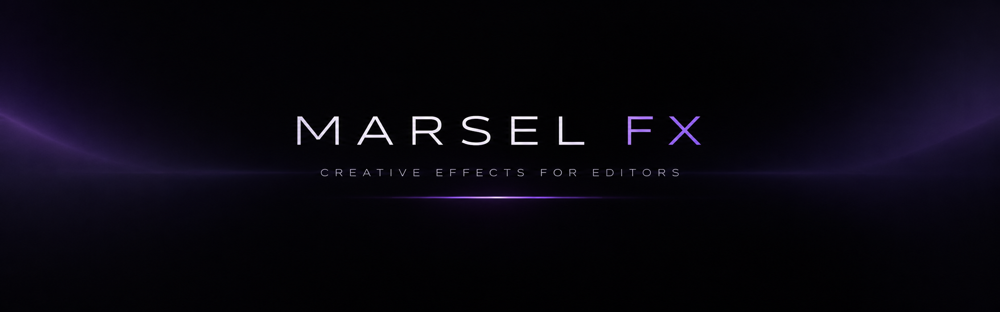
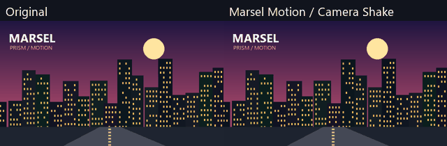
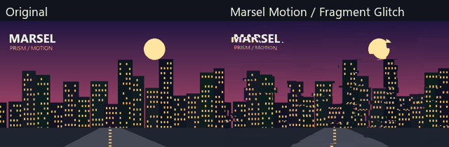
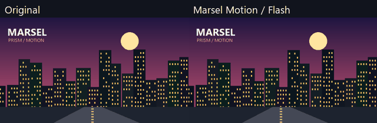

  

# ✦ MARSEL FX

Creative effects for editors who want more.

# ✦ MARSEL FX

**Creative effects for editors who want more.**

Free and open-source effects for **EffectCraft** and presets for **FilmCraft**.

**English** | [Русский](README.ru.md)

---

## ✦ About the Project

Welcome to **Marsel FX**, a collection of creative video effects built to make editing more flexible, accessible, and enjoyable.

The project is developed using AI-assisted coding, creative experimentation, and continuous improvements.

The goal is simple: **powerful creative tools should be accessible to everyone.**

- 🎨 17 effects in the current collection
- ✨ Two dedicated effect packs
- ⚡ Customizable parameters
- 🛠️ Ongoing development and improvements
- 💜 Free and open-source

## ✦ Explore the Packs

### 💎 MARSEL PRISM

**Light. Color. Texture. Atmosphere.**

A collection of 13 visual effects for cinematic looks, image processing, and creative styling.

| Effect | Description |
|---|---|
| Anamorphic Streak | Horizontal cinematic light streaks |
| Bloom | Soft highlight glow |
| Blur | Gaussian, box, and directional blur |
| Color Correction | Exposure, contrast, color, and tonal adjustments |
| Deep Glow | Multi-scale glow with customizable falloff |
| Drop Shadow | Adjustable shadows and gradients |
| Edge Glow | Glowing outlines and highlights |
| Film Grain | Film-inspired grain and texture |
| JPEG Damage | Compression-style image degradation |
| Pixelate | Pixel-based image stylization |
| RGB Split | Independent RGB channel displacement |
| Selective Light | Localized lighting and gradient controls |
| Vignette | Customizable edge darkening and color |

### ⚡ MARSEL MOTION

**Movement. Energy. Impact.**

Four effects designed for dynamic editing, motion, and visual transitions.

| Effect | Description |
|---|---|
| Camera Shake | Automated camera-style movement |
| Shake | Customizable motion and vibration |
| Fragment Glitch | Animated digital fragmentation |
| Flash | Rhythm-based color flashes |

## ✦ Effect Previews

### Camera Shake

### Fragment Glitch

### Flash

Additional visual comparisons and preview files are available in this repository.

## ✦ Installation & Compatibility

**EffectCraft:** The collection includes 17 custom WASM effects.

**FilmCraft:** The collection also includes 17 presets based on FilmCraft's built-in effects. Their capabilities may differ from the custom EffectCraft versions.

See [README.ru.md](README.ru.md) for more information about the current version, technical details, and compatibility notes.

Please note that compatibility can depend on the application version and available plugin support.

## ✦ Updates & Development

Marsel FX is an evolving project.

Future updates may include new effects, expanded controls, performance improvements, bug fixes, and additional creative tools.

**Current collection: v2.2.0**

Follow the repository to keep up with future releases.

## ✦ Ideas, Suggestions & Bug Reports

Have an idea for a new effect? Found a bug? Want to suggest an improvement?

Your feedback is welcome!

- [Open a GitHub Issue](https://github.com/maarrsel/maarsel/issues)
- **Discord:** `highroller_player`

Feel free to share feature requests, bug reports, or ideas for future packs.

## ✦ Support the Project

**Marsel FX is free, and I intend to keep it that way.**

If you enjoy using these effects and want to support future development, you can help by starring the repository, sharing the project, or supporting me through GitHub Sponsors.

Donations will go toward AI subscriptions and development tools that help me create and improve more plugins.

Every contribution is appreciated, but support is always optional.

## ✦ License & Credits

Distributed under the [MIT License](LICENSE).

See [ATTRIBUTION.md](ATTRIBUTION.md) for applicable credits and attributions.

## ✦ Thank You

Thank you to everyone who tries the effects, shares feedback, reports bugs, or supports this project.

**Made with creativity, experimentation, and a lot of iteration.**

*— Marsel*
